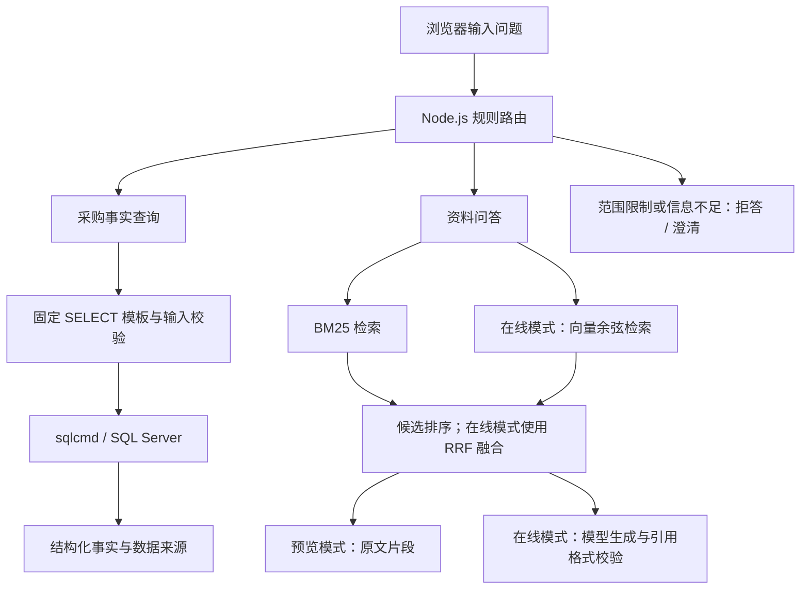

# 采购业务查询与 RAG 知识问答助手

基于 Node.js 与 SQL Server 的本地个人实践项目，将采购事实查询和业务资料问答整合到同一网页。采购事实实时读取数据库；资料问题通过检索后生成回答，并提供可核对的来源。

版本：0.4.0。代码与说明由 AI 辅助编写。

## 功能

| 场景 | 实现方式 |
| --- | --- |
| 采购明细、供应商采购金额、收货跟踪 | 规则识别问题，执行固定 SQL SELECT 模板 |
| 按采购单号或内部编号查订单 | 展示订单表头和商品明细；无明细时不编造数量 |
| 项目功能、业务口径和查询限制问答 | 检索项目说明与学习笔记，在线模式生成带来源的回答 |
| 知识资料维护 | 网页新建、导入 Markdown/TXT、编辑、停用和恢复 |
| 来源核对 | 展示资料标题、版本、章节、行号及检索候选 |

## 架构



知识资料按 Markdown 标题分节，长章节最多 550 字符，相邻片段重叠 80 字符。在线检索将 BM25 与向量候选通过 RRF 融合，默认选取 4 个片段作为上下文。向量保存在本地 JSON，使用精确余弦扫描，适用于当前小规模语料。

语料变化后重建整份语料的向量缓存。模型输出须包含合法来源编号；格式和来源编号校验不能保证每句回答的事实准确性。

## 技术栈

- Node.js 24+、JavaScript ES Modules；使用内置模块，无第三方 npm 依赖。
- HTML、CSS、原生 JavaScript 网页。
- SQL Server、sqlcmd、Windows 身份验证。
- BM25、向量余弦检索、RRF 排名融合。
- 项目已保存的在线验收配置使用 qwen-plus 与 text-embedding-v4。

## 快速开始

### 1. 准备运行环境

准备 Node.js 24 或更新版本。采购事实查询另需已配置的 SQL Server Inventory 练习数据库与 sqlcmd，并确认当前 Windows 账号可以连接。

本仓库不附带已运行的数据库。数据库结构与初始化脚本见关联项目 [Inventory-demo](https://github.com/Houstonyang/Inventory-demo)。其中建库脚本包含重置逻辑，仅在可清空的独立练习环境中按该项目说明操作。资料检索可先在 preview 模式体验；采购查询需要数据库。tests/inventory-sample.sql 是自动测试用的 SQLite 等价回放素材，不能当作完整 SQL Server 初始化脚本。

### 2. 配置

在项目根目录执行：

```powershell
Copy-Item .env.example .env
```

编辑 .env，按自己的环境填写：

```ini
RAG_MODE=preview
RAG_PORT=8791
RAG_SQL_SERVER=你的SQLServer实例
RAG_SQL_DATABASE=Inventory
RAG_SQLCMD_PATH=你的SQLCMD.EXE完整路径
```

启用模型问答时，将 RAG_MODE 改为 online，并填写 RAG_API_KEY、RAG_BASE_URL、RAG_CHAT_MODEL、RAG_EMBED_MODEL。修改后重启服务。在线模式会向所配置的模型服务发送问题及知识资料；采购事实查询不依赖模型接口。

### 3. 启动

Windows 下双击“启动.cmd”，或在项目目录运行：

```powershell
npm start
```

成功后访问 `http://127.0.0.1:8791`。服务在后台运行，启动窗口可以关闭。该地址仅供本机访问。停止服务可双击“停止服务.cmd”或运行 npm stop；查看状态运行 npm run status。需要实时日志时运行 npm run start:foreground。

本项目没有设置开机自启动，电脑重启或账号注销后需要重新启动服务。

## 模式与演示问题

| 模式 | 资料问题 | 采购事实问题 |
| --- | --- | --- |
| preview | 本地 BM25 检索，展示原文片段和来源 | 查询 SQL Server |
| online | BM25 与向量混合检索，模型生成带引用回答 | 查询 SQL Server |

可尝试：

- “PO20260915001 还差多少？”——在已验收的样例库中，精密轴承订购 500、实收 300、待收 200；数据库变化后以实时结果为准。
- “供应商采购金额汇总的口径是什么？”——资料问答，核对金额来源和分组方式。
- “收货跟踪表有哪些查询限制？”——核对入库状态与重复明细等统计边界。
- “列出逾期订单”——现有表缺少预计到货日期，返回能力范围说明。

通过网页编辑资料版本并保存后，再次提问可核对新版本是否进入检索。停用资料仍保留在本地，但不再参与检索。

## 验证记录

以下为交付包保存的 2026-10-12 本机验收记录，本次公开整理没有重新调用模型或数据库。公开整理与本轮本地检查见 [发布检查](docs/发布检查.md)，历史验收摘要见 [验收摘要](docs/验收摘要.md)。

| 项目 | 记录结果 | 解释 |
| --- | --- | --- |
| 代码测试 | 31/31 | 包括资料管理、HTTP、模拟模型接口和后台服务等测试 |
| SQL Server 检查 | 8/8 | 样例查询、数量口径、无明细草稿、供应商金额及查询前后表行数 |
| 在线自动检查 | 8/8 | 4 道真实模型资料题与 4 道程序范围路由题 |
| 模型核心事实复核 | 4/4 | 交付记录对功能归属、收货范围、金额口径及草稿数量作了复核 |
| 网页操作 | 8/8 | 交付记录包含资料增改、停用恢复、导入、持久化与问答查询检查 |

小样本检查通过不能表述为整体准确率 100%。查询前后表行数一致不等于逐字段比较了数据库。

本地检查命令：

```powershell
npm test
npm run evaluate
```

配置数据库后可以运行 npm run verify:sql；该脚本会检查连接，并可能将验证成功的本机连接方式写入 .env。配置模型后可以运行 npm run evaluate:online，该命令会真实调用模型接口。

## 目录

```text
src/          服务、规则路由、SQL 查询、检索、模型调用、资料管理
public/       网页界面
scripts/      启停、资料评估及 SQL 验证脚本
data/         知识资料、资料清单与评估问题
tests/        自动测试与测试数据
docs/         配置、使用和验收说明
reports/      本地运行生成的报告（Git 默认忽略）
.env.example  示例配置
```

## 适用范围与限制

当前为本地学习实践，未验证生产并发、多人权限控制或大规模语料性能。应用只发送固定 SELECT 查询，不支持任意自然语言生成 SQL；Windows 账号自身权限没有因此改变。

销售、库存余额与流水、自动过账、负库存检查、预警等尚未实现。收货跟踪保留原查询口径，不筛选入库状态，同订单同商品重复明细存在原有统计限制；供应商金额按名称分组，取自订单明细，不等于实际入库金额或付款金额。

知识来源中的原项目 README 为本地快照，不会自动同步远端。资料的静态样例值不替代数据库实时结果。
